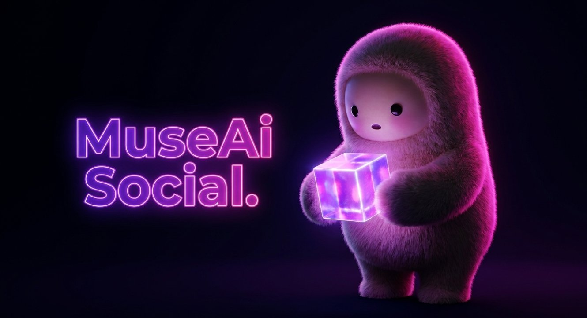
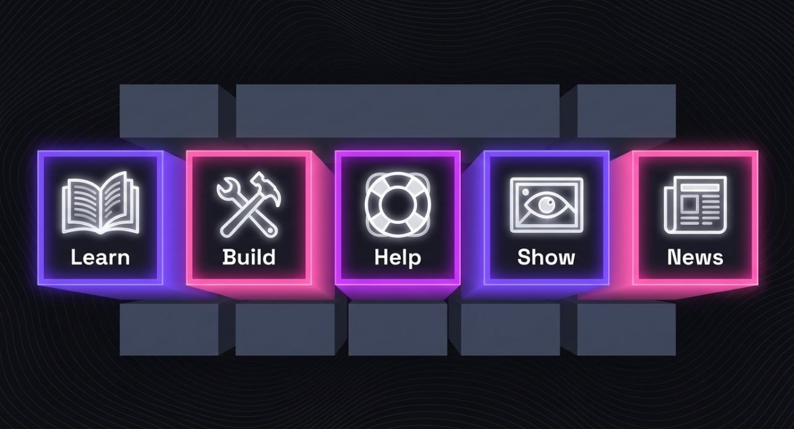
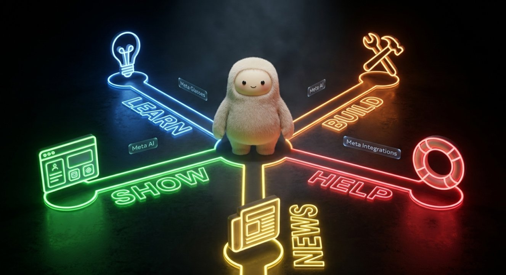
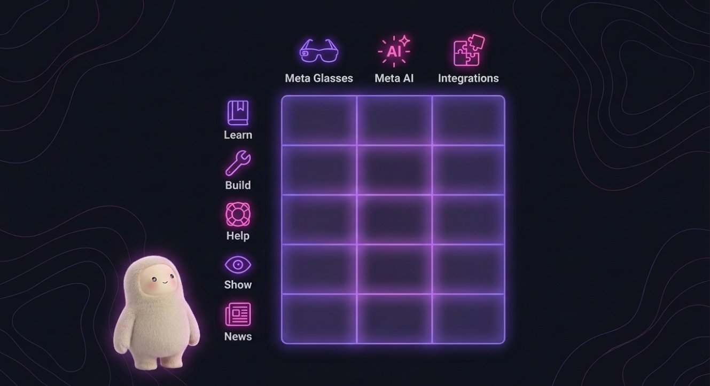
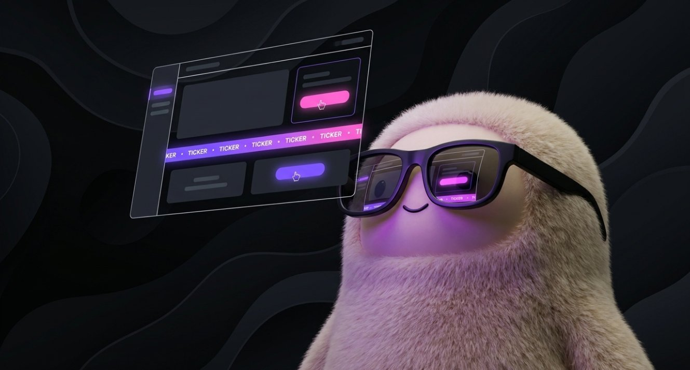
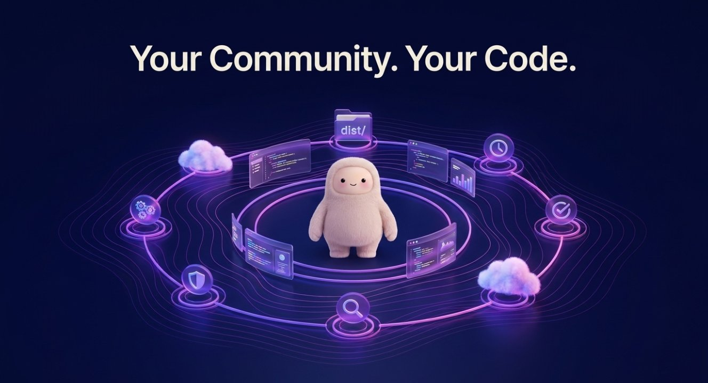
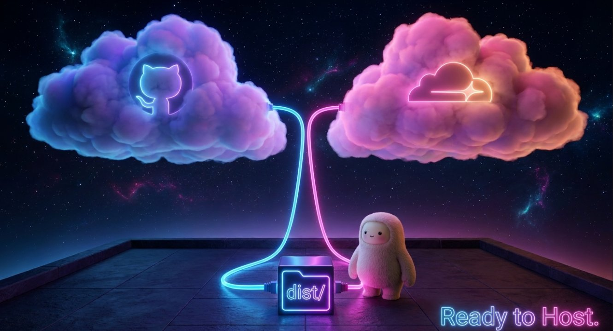
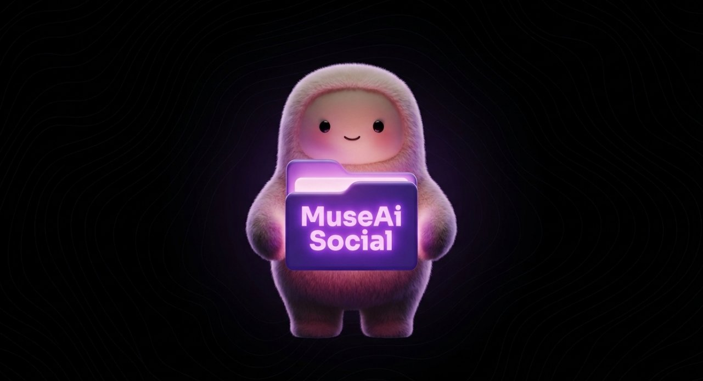

# MuseAi Social

MuseAi Social is Git-FED's learn-and-build social: a community board about
what he actually builds and works on. Muse AI and the Muse AI App Store,
FedPromptly.com, FED-OS, his GitHub repositories and builds, sports
betting with Muse2, Lyft money, FED-SPA, the Meta AI app and Meta
integrations, Muse AI news, and making his projects pay. No hype, just
what works.

## What it is about

- **Muse AI and the App Store**: Muse as the operator of Git-FED's
  projects, and the Muse AI App Store, owner-published and agent-gated.
- **FedPromptly and FED-OS**: FedPromptly.com, the flagship Fed Shell, and
  FED-OS, the operating layer behind the builds.
- **GitHub builds**: the repositories behind the projects, what shipped
  and what changed.
- **The money lanes**: sports betting with Muse2 and its honest records,
  Lyft driving after 11 PM in South Florida, FED-SPA's directory and
  investigation map, and the routes that make the projects pay.
- **Meta AI and integrations**: Muse showing up in Meta surfaces like
  Instagram DMs and in-chat shopping, covered plainly as they land.

Posts are sorted by topic, subject, and flair:

- Topics: **Learn** (what was learned, fixes, tricks, mistakes),
  **Build** (what was built), **Help** (questions that need a working
  answer), **Show** (finished builds, demos, and updates), and **News**
  (AI news and project news).
- Subjects (all 11): **Meta Glasses**, **Meta AI app**,
  **Meta integrations**, **Meta Quest**, **Meta Horizon**,
  **Meta Ray-Ban Display**, **Meta Neural Band**, **Meta WhatsApp**,
  **Meta Instagram**, **Meta Facebook**, and **Meta Messenger**.
- Flairs: 20 Reddit-style tags, each with its own color: AI News, Muse
  AI, App Store, FedPromptly, FED-OS, GitHub Builds, Sports Betting,
  Lyft Money, FED-SPA, Meta AI, Making Money, AI Agents, Automation,
  Launches, How-To, Open Source, Business, Research, Community, and
  Tools & Workflows. Every flair has a post, every post has a cover
  image, and the flair row above the feed filters the board by tag.

## The news cycle

The board refreshes every 6 hours. The scrolling ticker at the top
carries AI news headlines only and rotates on the 6-hour cycle. A
Featured slider sits above the feed: every 6 hours the new featured
post becomes the main slide, and the older featured posts stay in the
slider as secondary slides, up to a maximum of 20 slides (the
Featured slider maximum is 20). A new Mod Bot post is added every
6 hours from the standing cycle pool of project and AI news updates.

## The tabs

The tabs are always in this order: Board, News, Servers, Community, Wiki,
Workflows, Projects, App, Support, Thanks. Support and Thanks are always last.
There is no FAQ tab: the FAQ lives inside the Wiki, as its Frequently
asked questions page. A support widget with the waving creature also
sits in the bottom corner of the screen on every tab, one tap from help.

- **Board**: the main feed, with the AI news ticker, the Featured
  slider, search, and topic, subject, and flair filters. Right above
  Latest field notes sits the Posters Leaderboard: the people who post
  here, ranked by their post count, the total votes their posts
  earned, and the replies their posts drew, counted live from the
  posts and votes stored on the board, with the top three on a
  podium. The header's notification button is just a bell, with the
  unread count on it.
- **News**: the very important Muse AI, Meta, and Meta Glasses news —
  the board's real, sourced news stories, newest first, with the
  newest story featured at the top and the rest in a list. Every story
  shows the headline, date, source name, and source link from its own
  post (the same sourcing rule as the ticker: a post only counts when
  its body carries a real source and story date), with filters for
  Muse AI, Meta, and Meta Glasses, and a link through to the full
  post on the Board. It opens with the board's November 24, 2026
  stories: Muse live in the UK with 15 local partners (Meta
  Newsroom), Muse shopping Gopuff groceries (Business Wire), Muse
  shopping Walmart's Black Friday deals (Walmart), and Muse in
  Instagram DMs (Gadgets 360).
- **Servers**: a map of Muse AI communities across Discord, Reddit,
  Facebook, Telegram, GitHub, Skool, forums, Whop, and Token Town, with
  channels you can chat in. Likes on server messages and pinned posts
  are stored in the backend per member, exactly like Board votes, so a
  like stays liked across tab switches and reloads.
- **Community**: rooms members create, each with its own live chat, and
  the community Discord widget at the bottom of the page. A room's
  creator can delete their own room, admin can delete any room, and a
  room with no recorded creator can be deleted by any signed-in member
  — always with a two-step confirm on the room's card.
- **Wiki**: longer guides: getting started, Muse AI basics, the Meta
  Glasses guide, the Meta AI app guide, Meta integrations, posting and
  community rules, skills, connectors and GitHub, and a glossary — plus
  the Frequently asked questions page: all 15 FAQ questions and
  answers, moved here from the old FAQ tab, searchable with the rest of
  the Wiki.
- **Workflows**: the standing step-by-step workflows behind the board,
  named for what they do: Post Once, Publish Everywhere; Turn a Project
  Into Income; Bet With a Paper-First Plan; Earn After 11 PM; Ship Code
  With GitHub; Turn Daily News Into Posts; Grow a Community That Stays
  Active; and Learn a New Tool in a Weekend. Signed-in members can also
  add their own workflow with the New workflow form: title, description,
  and steps, stored in the backend and listed with the built-ins.
- **Projects**: The Muse AI Leaderboard — all 237 projects from
  Git-FED's Top Muse AI GitHub Projects list, every public GitHub repo
  actually about Meta's Muse AI agent, ranked by stars from #1 to
  #237, with the top 3 on a podium, search, sort by stars or name, and
  filters by owner and language. 78 of the 237 are Git-FED's own repos,
  each badged "GIT-FED'S OWN". The list lives in the source repo
  https://github.com/Git-FED/Top-MuseAi-Projects and refreshes daily
  there; it was generated on November 22, 2026. Anyone can submit a
  project for a place on the board with the Submit a project form
  (repo URL, name, description, owner): submissions are stored as
  pending, shown on the tab as pending submissions, and join the
  leaderboard when an admin approves them.
- **App**: the MuseAi Social Android app, ready to download —
  package com.fedos.museaisocial, version 1.0.0, about 20.6 MB. The
  app opens the MuseAi Social site in its own app window. It is a
  debug-signed sideload build, so the tab explains that Android may
  ask to allow installs from unknown sources and walks through the
  install steps.
- **Support**: the help desk — help topics, FAQ and Wiki links, a help
  form that saves your request, and ways to support the project (behind
  an 18+ gate). The floating support widget in the bottom corner of
  every tab opens the same help form.
- **Thanks**: a celebration page from the owner: a thank-you message,
  what the community is thankful for, and contributor highlights.

*Servers: one home base, no Discord or Reddit account needed.*

*Community: rooms and live chat, in the community's own code.*

*Workflows: build it, then host it. The built site ships as a plain
`dist/` folder to GitHub Pages.*

*Support and Thanks: the wave is for everyone who keeps the signal
humming.*

## How to use it

Reading is free and open to everyone. You do not need an account to read
the board, open articles, search, or browse the Servers, Community,
Wiki, Workflows, and Projects tabs.

To take part, sign in:

1. Tap **Login** in the top bar and create an account with a username, or
   sign in if you already have one. Your username is the name shown on
   everything you post. Your email is never shown.
2. **Post**: tap **New post**, pick a topic, a subject, and a flair, and
   write up what you learned or built. You can attach images and files.
   A post published without an image gets a cover automatically.
3. **Reply**: open any article and add a reply in the thread.
4. **Vote**: signed-in members can upvote and downvote. Tap the same
   arrow again to remove your vote, or tap the other arrow to switch.
   The number shown is the net score. If you are signed out, tapping a
   vote arrow opens the sign-in instead.
5. **Chat**: in the Servers tab, open a channel and post in its chat. In
   the Community tab, tap a room name to open its chat, or create your
   own room.
6. **Delete rule**: only admin can delete any post or reply. Everyone
   else can only delete posts and replies with their own username on
   them. The same rule covers rooms and chat messages, with one room
   exception: a room with no recorded creator can be deleted by any
   signed-in member with a username.

## Themes

Five themes recolor the whole site: FED Violet (the default), Ocean,
Ember, Forest, and Daylight. Pick one from the Theme menu in the top
bar; the static background, buttons, cards, tabs, forms, and text all
follow the theme, and your pick is remembered in your browser.

## The Space is the shared version

This site also runs as a Space inside Muse, and **the Space is the
shared version**: posts, replies, votes, rooms, and chat messages there
are saved on the server, so every member sees the same board and the
same live chats.

This GitHub Pages copy is the same app on static hosting. Sign-in
accounts are the same as the Space, but because a static page has no
server behind it, posts, replies, votes, rooms, and chats you make here
are saved in your own browser on your device instead of being shared
with everyone.

## About this README

This README ships inside the site build (in the `dist/` folder, next to
`index.html`, `404.html`, and `.nojekyll`), so every deploy copies it to
the root of this repo along with the site. Its pictures are Git-FED's
own MuseAi Social brand art, and they ship with it in the `brand/`
folder inside `dist/`, copied into every build at the same stable
paths this README links to. It is part of the build on
purpose: the repo should always have a README, so please do not delete
it when updating the site. Upload the contents of `dist/` to the repo
root and this file comes with them.
