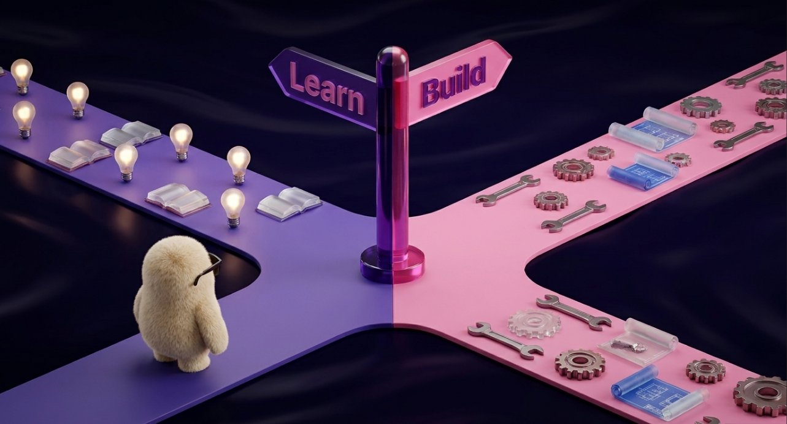
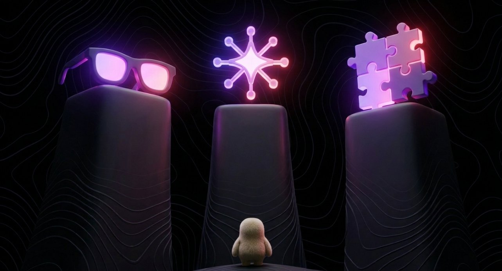
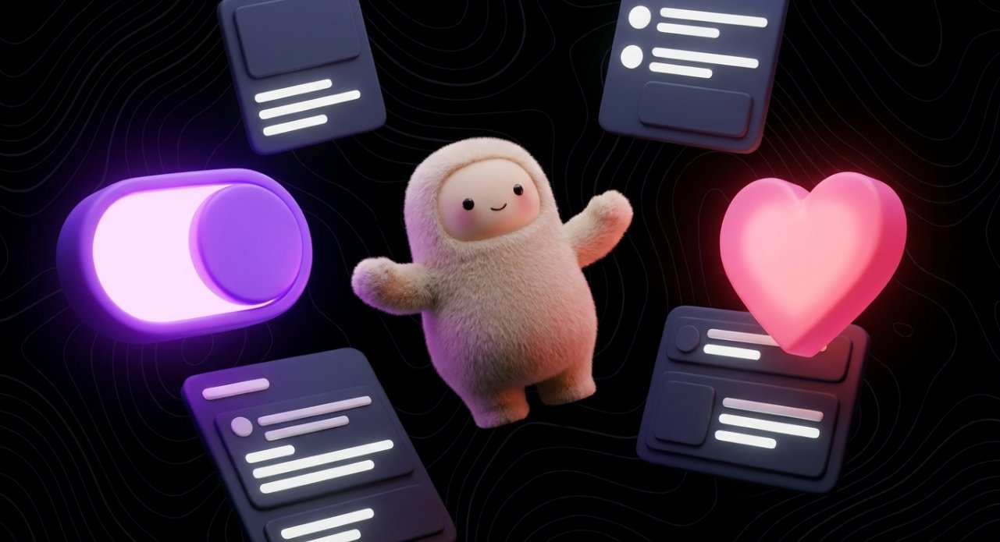

# MuseAi Social

MuseAi Social is Git-FED's learn-and-build social: a community board about
what he actually builds and works on. Muse AI and the Muse AI App Store,
FedPromptly.com, FED-OS, his GitHub repositories and builds, sports
betting with Muse2, Lyft money, FED-SPA, the Meta AI app and Meta
integrations, Muse AI news, and making his projects pay. No hype, just
what works.

## What it is about

- **Muse AI and the App Store**: Muse as the operator of Git-FED's
  projects, and the Muse AI App Store, owner-published and agent-gated.
- **FedPromptly and FED-OS**: FedPromptly.com, the flagship Fed Shell, and
  FED-OS, the operating layer behind the builds.
- **GitHub builds**: the repositories behind the projects, what shipped
  and what changed.
- **The money lanes**: sports betting with Muse2 and its honest records,
  Lyft driving after 11 PM in South Florida, FED-SPA's directory and
  investigation map, and the routes that make the projects pay.
- **Meta AI and integrations**: Muse showing up in Meta surfaces like
  Instagram DMs and in-chat shopping, covered plainly as they land.

Posts are sorted by topic, subject, and flair:

- Topics: **Learn** (what was learned, fixes, tricks, mistakes),
  **Build** (what was built), **Help** (questions that need a working
  answer), **Show** (finished builds, demos, and updates), and **News**
  (AI news and project news).
- Subjects (all 11): **Meta Glasses**, **Meta AI app**,
  **Meta integrations**, **Meta Quest**, **Meta Horizon**,
  **Meta Ray-Ban Display**, **Meta Neural Band**, **Meta WhatsApp**,
  **Meta Instagram**, **Meta Facebook**, and **Meta Messenger**.
- Flairs: 20 Reddit-style tags, each with its own color: AI News, Muse
  AI, App Store, FedPromptly, FED-OS, GitHub Builds, Sports Betting,
  Lyft Money, FED-SPA, Meta AI, Making Money, AI Agents, Automation,
  Launches, How-To, Open Source, Business, Research, Community, and
  Tools & Workflows. Every flair has a post, every post has a cover
  image, and the flair row above the feed filters the board by tag.

## The news cycle

The board refreshes every 6 hours. The scrolling ticker at the top
carries AI news headlines only and rotates on the 6-hour cycle. The
ticker loop is a seamless infinite scroll at reading pace: the track
carries two identical copies of the headline list and translates
exactly one copy width, so there is no jump, no gap, and no blank
space, and its speed is set by reading pace — about 16.25 seconds
per headline, so the current 8 headlines loop in about 130 seconds.
The background behind it stays completely static. A
Featured slider sits above the feed: every 6 hours the new featured
post becomes the main slide, and the older featured posts stay in the
slider as secondary slides, up to a maximum of 20 slides (the
Featured slider maximum is 20). A new Mod Bot post is added every
6 hours from the standing cycle pool of project and AI news updates.
No two posts share an image: all 44 posts on the Board and the
News tab now carry brand-new covers, redone one per post. Each
cover is its own scene matched to its post's topic, with its own
style, palette, setting, angle, and creature pose — the betting
posts get a stadium ledger at dawn and a kitchen-table formula
book, the FED-SPA posts a top-down paper street map and an explorer
desk, the pipeline posts a rooftop paper-plane launch deck and a
conveyor belt, and so on through all 44. Every cover shows the
same Muse AI agent: the soft fluffy cream and beige plush
creature with the rounded furry hood, pale cream face, two small
black dot eyes, small simple smile, and soft pink blush cheeks —
no tail, no robot, no metal, no visor, no antenna. The old starter
covers and the paper-craft story set are no longer assigned to any
post. This static copy assigns the exact same 44 covers by post
slug, so Pages shows the same distinct images as the Space, and a
repair pass on load reassigns any cover that collides in a
returning visitor's stored board — so no two posts share a cover
on the Board or the News tab, here or in the Space. The stale
paper-craft covers are fixed for good: a load-time repair in this
static copy reassigns any stored post still carrying a pre-redo
cover — an old cover-* starter, a paper-craft cover-story-* spare,
or an old news key — to its redone c3 cover, with cycle posts
matched to their entry by title, so a stored "Cycle update:
FedPromptly is the front door" post moves from cover-story-desk
to c3-front-door, the same cover as its 2026-11-26 copy. The old
fallback pools are deleted entirely — the 22 cover-* starters and
the 8 paper-craft cover-story-* spares no longer exist in the
code — the last-resort cover rotation cycles only c3 covers, and
the backfill map and news seed entries carry c3 keys, so no code
path in this copy can serve a paper-craft cover again.

## The tabs

The tabs are always in this order: Board, News, Servers, Community, Wiki,
Workflows, Projects, App, Support, Thanks. Support and Thanks are always last.
There is no FAQ tab: the FAQ lives inside the Wiki, as its Frequently
asked questions page. A support widget with the waving creature also
sits in the bottom corner of the screen on every tab, one tap from help.

- **Board**: the main feed, with the AI news ticker, the Featured
  slider, search, and topic, subject, and flair filters. Right above
  Latest field notes sits the Posters Leaderboard: the people who post
  here, ranked by their post count, the total votes their posts
  earned, and the replies their posts drew, counted live from the
  posts and votes stored on the board, with the top three on a
  podium. The header's notification button is just a bell, with the
  unread count on it.
- **News**: the very important Muse AI, Meta, and Meta Glasses news —
  the board's real, sourced news stories, newest first, with the
  newest story featured at the top and the rest in a list. Every story
  shows the headline, date, source name, and source link from its own
  post (the same sourcing rule as the ticker: a post only counts when
  its body carries a real source and story date), with filters for
  Muse AI, Meta, and Meta Glasses, and a link through to the full
  post on the Board. It carries 13 real sourced stories: the four
  November 24, 2026 stories — Muse live in the UK with 15 local
  partners (Meta Newsroom), Muse shopping Gopuff groceries
  (Business Wire), Muse shopping Walmart's Black Friday deals
  (Walmart), and Muse in Instagram DMs (Gadgets 360) — plus nine
  more: Muse on Apple Watch and Wear OS (emergent.sh,
  November 10), Realtime Avatar video chat and Muse Voice
  (Meta Newsroom, November 5), Muse's own email address,
  handle@muse.ai (Built With Muse, November 20), Muse phoning
  US businesses for paid subscribers (TechCrunch, November 12),
  the Ray-Ban Meta Gen 3 and Ray-Ban Meta Audio launch
  (Meta Newsroom, September 23), Muse for Mac computer use
  (museaicodes.com, September 23), the Montana AG multistate probe
  into Muse (DataGuidance, November 23), Muse placing 51% of
  AI-agent shopping orders (Forter Intelligence, November 24),
  and Muse's shopping orders hitting a wall as retailers block
  AI agents (CNBC, reported by allthingsmuse.com, November 27).
  Every one of the 13 carries its own distinct c3 cover, and the
  CNBC shopping story is also inserted into a returning visitor's
  stored board on load, so this copy shows all 13 stories just
  like the Space.
- **Servers**: a map of Muse AI communities across Discord, Reddit,
  Facebook, Telegram, GitHub, Skool, forums, Whop, and Token Town, with
  channels you can chat in. Likes on server messages and pinned posts
  are stored in the backend per member, exactly like Board votes, so a
  like stays liked across tab switches and reloads.
- **Community**: rooms members create, each with its own live chat, and
  the community Discord widget at the bottom of the page. Every room
  card carries a visible red-outlined "Delete room" button in the same
  row as "Open chat", whether you are signed in or out. Tapping it
  opens the two-step confirm — "Delete this room?" / "Yes, delete" /
  "Cancel" — for anyone allowed to delete: admin, the room's creator,
  or any signed-in member for a room with no recorded creator. Anyone
  else tapping it gets the reason shown in that card (sign in, or only
  the room's creator or admin can delete it) instead of a missing
  button.
- **Wiki**: longer guides: getting started, Muse AI basics, the Meta
  Glasses guide, the Meta AI app guide, Meta integrations, posting and
  community rules, skills, connectors and GitHub, and a glossary — plus
  the Frequently asked questions page: all 15 FAQ questions and
  answers, moved here from the old FAQ tab, searchable with the rest of
  the Wiki.
- **Workflows**: the standing step-by-step workflows behind the board,
  named for what they do: Post Once, Publish Everywhere; Turn a Project
  Into Income; Bet With a Paper-First Plan; Earn After 11 PM; Ship Code
  With GitHub; Turn Daily News Into Posts; Grow a Community That Stays
  Active; and Learn a New Tool in a Weekend. Signed-in members can also
  add their own workflow with the New workflow form: title, description,
  and steps, stored in the backend and listed with the built-ins.
- **Projects**: The Muse AI Leaderboard — all 237 projects from
  Git-FED's Top Muse AI GitHub Projects list, every public GitHub repo
  actually about Meta's Muse AI agent, ranked by stars from #1 to
  #237, with the top 3 on a podium, search, sort by stars or name, and
  filters by owner and language. 78 of the 237 are Git-FED's own repos,
  each badged "GIT-FED'S OWN". The list lives in the source repo
  https://github.com/Git-FED/Top-MuseAi-Projects and refreshes daily
  there; it was generated on November 22, 2026. Anyone can submit a
  project for a place on the board with the Submit a project form
  (repo URL, name, description, owner): submissions are stored as
  pending, shown on the tab as pending submissions, and join the
  leaderboard when an admin approves them.
- **App**: the MuseAi Social Android app, ready to download —
  package com.fedos.museaisocial, version 1.0.0, about 20.6 MB. The
  app opens the MuseAi Social site in its own app window. It is a
  debug-signed sideload build, so the tab explains that Android may
  ask to allow installs from unknown sources and walks through the
  install steps. Below the Android section sits the Desktop section,
  headed "Desktop app — Windows, version 1.0.0": the Windows app is
  coming — a single-window Electron wrapper around the same site,
  with your login staying saved — and there is no installer file to
  download yet. Its "How to get the Windows app" card lists the four
  real steps: upload the desktop source to the MuseAi-Social repo
  root via the GitHub web UI (package.json, main.js, assets/ and
  .github/workflows/build-desktop.yml at the top level), push to
  main or run the "Desktop build" workflow by hand from the repo's
  Actions tab, download the museai-social-desktop-windows artifact
  from the finished run (it holds "MuseAi Social Setup 1.0.0.exe"
  and the portable .exe), then run the installer and click "More
  info" and "Run anyway" past the unsigned-build SmartScreen
  warning. A "Mac and Linux too" card notes the same workflow also
  builds a macOS .dmg (museai-social-desktop-macos artifact) and a
  Linux .AppImage (museai-social-desktop-linux artifact). The
  section's only button links to the repo's real Actions page,
  https://github.com/Git-FED/MuseAi-Social/actions — there is no
  Windows download button, because no .exe exists until that
  workflow runs. The Desktop section also carries a Linux
  subsection, "Desktop app — Linux, version 1.0.0": the Linux build
  is real and ready — the same Electron wrapper packaged as an
  AppImage (MuseAi-Social-Desktop-1.0.0.AppImage, about 99 MB,
  Linux x86-64) — with a gradient "Download for Linux" button for
  the hosted AppImage, a mirror link to the same file name in the
  site root, and the run steps: make the file executable and run
  it, no install needed. The tab's art is 11 images Git-FED sent on
  November 28, 2026, each used exactly once on the App tab and
  nowhere else — the shared brand images (brand-hero, brand-tiles,
  brand-grid, brand-build, brand-fork, brand-host) no longer appear
  on this tab. The 11, in the order they appear on the tab:
  (1) the creature holding a glowing purple cube under the
  MuseAi Social wordmark, the tab's hero; (2) "Ready." — the
  creature waving beside a purple gift box, in the install card;
  (3) the creature popping out of a glowing gift box over
  MUSEAI SOCIAL lettering, beside it; (4) SCOPE — three panels,
  Glasses, App, and Integrations, closing the Android section;
  (5) "Learn. Build." — the neon circuit diagram, the Desktop
  section's figure; (6) the creature launching a paper plane
  toward the GitHub cloud, in the "Mac and Linux too" card;
  (7) the creature from behind in a neon violet city, beside it;
  and in the "New app art" gallery row: (8) the creature in neon
  glasses holding a glowing star over MuseAi Social lettering,
  (9) the creature holding the dist/ folder while snakes and
  barrels pour through a neon funnel, (10) the creature looking
  at a glowing 18+ shield, and (11) a wavy-lines background with
  a single violet star and no creature.
- **Support**: the help desk — help topics, FAQ and Wiki links, a help
  form that saves your request, and ways to support the project (behind
  an 18+ gate). The floating support widget in the bottom corner of
  every tab opens the same help form. Each request shows as a box with
  its synced status (Open, In progress, or Resolved) and a reply
  thread, both stored in the backend: admin (username admin) sees every
  request, can change its status, and can reply in the box, and the
  person who sent it sees the status and admin replies on their own
  box; everyone else sees only their own requests.
- **Thanks**: a celebration page from the owner: a thank-you message,
  what the community is thankful for, and contributor highlights.

*Servers: one home base, no Discord or Reddit account needed.*

*Community: rooms and live chat, in the community's own code.*

*Workflows: build it, then host it. The built site ships as a plain
`dist/` folder to GitHub Pages.*

*Support and Thanks: the wave is for everyone who keeps the signal
humming.*

## One image, one spot

Every picture on the site belongs to exactly one spot. Git-FED's 14
brand images — his own uploads from November 26, 2026, kept
byte-for-byte — each appear in exactly one place on the site: the
Board hero, the two Board highlight cards, the six "How the board
works" cards, the Board Trending figure, the Servers hero, the Wiki
hero, the Workflows "Ready to host" figure, and the Good Notes
post's cover. Every other spot that used to repeat one of those
brand images now has its own new picture of the fluffy cream Muse
AI agent creature, drawn for that spot alone: 19 of them, across the
Board filter rows and third highlight card, the News, Community,
Support, and Thanks heroes and cards, the Workflows and Projects
figures, and the support widget. The robots are gone: the Wiki's
Getting started and Muse AI basics banners and the Servers banner
were redrawn with the same tail-free cream creature, and the avatar
picture is the cream creature too. The Workflows and Projects tabs
no longer borrow Board post covers, and the App tab's 11 images stay
only on the App tab.

## How to use it

Reading is free and open to everyone. You do not need an account to read
the board, open articles, search, or browse the Servers, Community,
Wiki, Workflows, and Projects tabs.

To take part, sign in:

1. Tap **Login** in the top bar and create an account with a username, or
   sign in if you already have one. Your username is the name shown on
   everything you post. Your email is never shown.
2. **Post**: tap **New post**, pick a topic, a subject, and a flair, and
   write up what you learned or built. You can attach images and files.
   A post published without an image gets a cover automatically.
3. **Reply**: open any article and add a reply in the thread.
4. **Vote**: signed-in members can upvote and downvote. Tap the same
   arrow again to remove your vote, or tap the other arrow to switch.
   The number shown is the net score. If you are signed out, tapping a
   vote arrow opens the sign-in instead.
5. **Chat**: in the Servers tab, open a channel and post in its chat. In
   the Community tab, tap a room name to open its chat, or create your
   own room.
6. **Delete rule**: only admin can delete any post or reply. Everyone
   else can only delete posts and replies with their own username on
   them. The same rule covers rooms and chat messages, with one room
   exception: a room with no recorded creator can be deleted by any
   signed-in member with a username.

## Themes

Five themes recolor the whole site: FED Violet (the default), Ocean,
Ember, Forest, and Daylight. Pick one from the Theme menu in the top
bar; the static background, buttons, cards, tabs, forms, and text all
follow the theme, and your pick is remembered in your browser.

## The Space is the shared version

This site also runs as a Space inside Muse, and **the Space is the
shared version**: posts, replies, votes, rooms, and chat messages there
are saved on the server, so every member sees the same board and the
same live chats.

This GitHub Pages copy is the same app on static hosting. Sign-in
accounts are the same as the Space, but because a static page has no
server behind it, posts, replies, votes, rooms, and chats you make here
are saved in your own browser on your device instead of being shared
with everyone.

## About this README

This README ships inside the site build (in the `dist/` folder, next to
`index.html`, `404.html`, and `.nojekyll`), so every deploy copies it to
the root of this repo along with the site. Its pictures are Git-FED's
own MuseAi Social brand art, and they ship with it in the `brand/`
folder inside `dist/`, copied into every build at the same stable
paths this README links to. It is part of the build on
purpose: the repo should always have a README, so please do not delete
it when updating the site. Upload the contents of `dist/` to the repo
root and this file comes with them.
